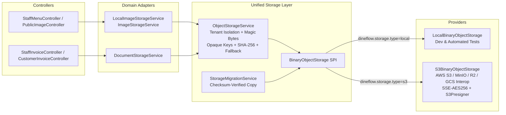

# DineFlow Cloud Object Storage Architecture (S3 / GCS-Compatible)

This document details DineFlow's unified, provider-independent object storage architecture for menu images, tax invoice PDFs, and authorized business documents.

---

## 1. Storage Architecture Diagram



---

## 2. Object Key Layout & Security Controls

| Category | Opaque Key Pattern | Max Size | Allowed Content Types (Magic-Byte Verified) | Access Model |
| :--- | :--- | :--- | :--- | :--- |
| `MENU_IMAGE` | `images/{tenantId}/{entityId}/{uuid}.{ext}` | 5 MB | `image/jpeg`, `image/png`, `image/webp` | Public menu read via `/api/v1/public/images/**` (strictly restricted to `images/` prefix) |
| `INVOICE_PDF` | `documents/invoices/{tenantId}/{entityId}/{uuid}.pdf` | 10 MB | `application/pdf` (`%PDF-`) | Strictly private; tenant + branch + guest-session authorization + SHA-256 verification on download |
| `BUSINESS_DOCUMENT` | `documents/general/{tenantId}/{entityId}/{uuid}.{ext}` | 10 MB | PDF, JPEG, PNG, WebP, CSV, TXT | Strictly private; tenant-isolated; short-lived signed URLs (`<= 15 min`) only when authorized |

- **No user-supplied filenames in keys**: All keys use generated UUIDs and validated extensions.
- **Fail-fast production guard**: `ProductionConfigurationValidator` refuses to start the `prod` profile unless `dineflow.storage.type=s3` and non-blank `bucket` + `region` are configured.

---

## 3. Environment Variables

| Variable | Required in Prod | Default | Description |
| :--- | :---: | :--- | :--- |
| `DINEFLOW_STORAGE_TYPE` | Yes (`s3`) | `local` | Storage backend selector (`local` or `s3`). |
| `DINEFLOW_STORAGE_LOCAL_ROOT` | No | `uploads` | Local disk directory for dev/test and migration fallback reads. |
| `DINEFLOW_STORAGE_LOCAL_FALLBACK_READ` | No | `true` | Allows zero-downtime fallback read from local disk if object not yet migrated to S3. Set `false` after migration completes. |
| `DINEFLOW_STORAGE_S3_BUCKET` | Yes | — | Target private S3/MinIO/GCS bucket name. |
| `DINEFLOW_STORAGE_S3_REGION` | Yes | `ap-south-1` | AWS/S3 region (use `auto` for Cloudflare R2 or region for GCS). |
| `DINEFLOW_STORAGE_S3_ENDPOINT` | MinIO/GCS/R2 only | *(empty)* | Custom S3-compatible endpoint (e.g., `http://minio:9000` or `https://storage.googleapis.com`). |
| `DINEFLOW_STORAGE_S3_PATH_STYLE` | MinIO only | `false` | Set `true` for MinIO / self-hosted S3-compatible endpoints. |
| `AWS_ACCESS_KEY_ID` / `AWS_SECRET_ACCESS_KEY` | Use IAM Role in Prod | — | Prefer IAM Instance Profile / EKS IRSA / ECS Task Role over static keys. |

---

## 4. Production S3 Bucket & IAM Configuration

### Bucket Hardening Checklist
1. **Block Public Access**: Enable all 4 AWS S3 Block Public Access settings (`BlockPublicAcls`, `IgnorePublicAcls`, `BlockPublicPolicy`, `RestrictPublicBuckets`).
2. **Encryption at Rest**: Enable default SSE-S3 (`AES256`) or SSE-KMS (`aws:kms`) + bucket key.
3. **Bucket Versioning**: Enabled on `documents/invoices/` to protect fiscal records from accidental overwrite/deletion.
4. **TLS-Only Bucket Policy**: Deny any `s3:*` request where `aws:SecureTransport == false`.

### Least-Privilege IAM Policy (Application Task Role)

```json
{
  "Version": "2012-10-17",
  "Statement": [
    {
      "Sid": "DineFlowObjectAccess",
      "Effect": "Allow",
      "Action": [
        "s3:PutObject",
        "s3:GetObject",
        "s3:DeleteObject",
        "s3:HeadObject"
      ],
      "Resource": "arn:aws:s3:::dineflow-prod-assets/*"
    },
    {
      "Sid": "DineFlowBucketHead",
      "Effect": "Allow",
      "Action": "s3:ListBucket",
      "Resource": "arn:aws:s3:::dineflow-prod-assets",
      "Condition": {
        "StringLike": {
          "s3:prefix": ["images/*", "documents/*"]
        }
      }
    }
  ]
}
```

### GCS Interoperability Setup (Optional)
Google Cloud Storage supports the S3 XML API natively without adding extra SDK bloat:
- Set `DINEFLOW_STORAGE_TYPE=s3`
- Set `DINEFLOW_STORAGE_S3_ENDPOINT=https://storage.googleapis.com`
- Generate a GCS HMAC key for a least-privilege service account (`roles/storage.objectUser` on the bucket) and inject via Secret Manager.

---

## 5. Local Development (Local Disk & MinIO)

- **Default Dev / Tests**: Runs with `dineflow.storage.type=local` writing under `uploads/`.
- **Local S3-Compatible Testing (MinIO)**: `docker-compose.yml` includes a `minio` service on port `9000` (console `9001`). Set `DINEFLOW_STORAGE_TYPE=s3`, `DINEFLOW_STORAGE_S3_ENDPOINT=http://localhost:9000`, `DINEFLOW_STORAGE_S3_PATH_STYLE=true`.

---

## 6. Zero-Downtime Local-to-Cloud Migration & Rollback

1. **Dual-Read Cutover**: Deploy with `DINEFLOW_STORAGE_TYPE=s3` and `DINEFLOW_STORAGE_LOCAL_FALLBACK_READ=true`. New uploads go to S3; legacy unmigrated local files remain readable seamlessly.
2. **Copy & Checksum Verification**: Run `StorageMigrationService.migrateDirectoryToTarget(Paths.get("uploads"), s3Storage, false)`. Every file's SHA-256 is verified after re-reading from S3; source files are **not** deleted.
3. **Audit & Disable Fallback**: Once `failedCount == 0` and `verifiedCount == scannedFiles`, set `DINEFLOW_STORAGE_LOCAL_FALLBACK_READ=false` and archive the local `uploads/` volume.
4. **Rollback**: Because local source files are preserved until verification succeeds, rolling back simply requires reverting `DINEFLOW_STORAGE_TYPE=local`.

---

## 7. Backup, Retention, Recovery & Lifecycle Cost Optimization

- **Invoices (`documents/invoices/`)**: Transition to S3 Standard-IA after 90 days and S3 Glacier Instant Retrieval after 365 days; retain for 7–8 years per statutory tax compliance (Object Lock / WORM optional for regulated tenants).
- **Menu Images (`images/`)**: Keep in S3 Standard (or Intelligent-Tiering); expire non-current versions after 30 days.
- **Cross-Region Replication (CRR)**: Enable asynchronous CRR for `documents/invoices/` to a secondary region for disaster recovery.
- **Recovery**: Restore deleted/corrupted objects from S3 bucket version history or the CRR replica bucket and validate against `financial_document_records.checksum_sha256`.
