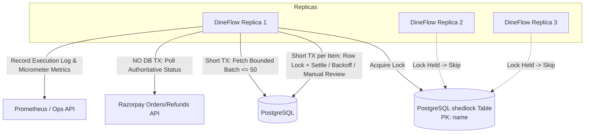

# DineFlow Distributed Scheduling, ShedLock & Payment Reconciliation Runbook

This document defines DineFlow's multi-replica scheduled job architecture, ShedLock configuration, exponential-backoff retry design, monitoring metrics, and incident recovery procedures.

---

## 1. Scheduled Job Inventory

| Job Name (ShedLock Key) | Schedule (`cron`) | `lockAtLeastFor` | `lockAtMostFor` | Batch Size | Purpose |
| :--- | :--- | :---: | :---: | :---: | :--- |
| `paymentReconciliationJob` | `0 */5 * * * *` (`dineflow.reconciliation.cron`) | `PT30S` | `PT4M` | 50 / run | Reconciles `PENDING_CONFIRMATION` and stale (`>15m`) `INITIATED`/`PENDING`/`PROCESSING` payments via authoritative provider status APIs. |
| `refundReconciliationJob` | `30 */5 * * * *` (`dineflow.reconciliation.refund-cron`) | `PT30S` | `PT4M` | 50 / run | Reconciles refunds stuck in `INITIATED` state after ambiguous gateway timeouts via `fetchRefundStatus(...)`. |

*(No unnecessary background jobs are introduced; expired guest sessions and rate-limit keys expire passively via JWT expiry and Redis `PEXPIRE` TTLs.)*

---

## 2. Distributed Scheduling Architecture

### ShedLock Configuration ([SchedulingConfig.java](file:///c:/Users/manoz/.gemini/antigravity/scratch/dineflow/backend/src/main/java/com/dineflow/config/SchedulingConfig.java))
- Uses `JdbcTemplateLockProvider` backed by the `shedlock` table (`V18__shedlock_and_sprint6_hardening.sql`).
- `lockAtMostFor = PT4M`: guarantees that even if a pod is OOM-killed mid-run, the lock expires automatically within 4 minutes so another replica resumes reconciliation.
- `lockAtLeastFor = PT30S`: prevents duplicate immediate re-execution caused by minor clock skew across replicas.
- **At-Least-Once Idempotency**: Because ShedLock does not guarantee exactly-once execution across network partitions, every payment and refund update reloads the row with `SELECT ... FOR UPDATE` and checks `PaymentStateMachine.isConfirmedOrRefunded(...)` / `refundStatus == INITIATED` before applying financial changes.

---

## 3. Retry Architecture & Dead-Letter (`manual_review_required`)

- **Schema (`V20__reconciliation_retry_and_job_observability.sql`)**:
  - `payment_attempts` & `restaurant_refunds`: `reconciliation_retry_count`, `next_reconciliation_at`, `manual_review_required`.
  - `payment_reconciliation_logs`: `duration_ms`, `retry_count`, `triggered_by` (`SCHEDULER` or `MANUAL_STAFF:{userId}`).
- **Exponential Backoff with Jitter (`ReconciliationRetryPolicy`)**:
  - `MAX_RETRIES = 5`, base `60s`, exponential `60s * 2^(n-1)` capped at `30m`, with `±15%` jitter.
  - Transient errors (`5xx`, `429`, connect/read timeout) increment retry count and schedule `next_reconciliation_at` — **never** marking a payment as `FAILED` or `CANCELLED`.
  - After 5 failed attempts, `manual_review_required = true` removes the item from automated polling and flags it for operator investigation (`RECONCILIATION_RETRY_EXHAUSTED_MANUAL_REVIEW`).

---

## 4. Operational Endpoints & Monitoring Metrics

### Authorized Operational Endpoints (`REPORT_FINANCIAL_VIEW` / `PAYMENT_PROCESS`)
- `GET /api/v1/payments/reconciliation/history` — Recent 20 tenant-scoped reconciliation runs (status, duration, scanned/reconciled/mismatch/retry counts, `triggeredBy`).
- `GET /api/v1/payments/reconciliation/locks` — Live `shedlock` table entries (`name`, `lockUntil`, `lockedAt`, `lockedBy`, `currentlyLocked`).
- `POST /api/v1/payments/reconciliation/run` — Audited manual payment reconciliation (`MANUAL_STAFF:{userId}`). Always verifies with upstream provider.
- `POST /api/v1/payments/reconciliation/refunds/run` — Audited manual refund reconciliation (`MANUAL_STAFF:{userId}`).

### Micrometer / Prometheus Metrics
- `dineflow_reconciliation_runs_total{type, status}` (`type=payment|refund`, `status=completed|failed`)
- `dineflow_reconciliation_duration_seconds{type, status}`
- `dineflow_reconciliation_items_total{type, outcome}` (`outcome=resolved|discrepancy|timed_out`)

---

## 5. Incident Recovery Runbook

1. **Stuck ShedLock Row**:
   - Inspect `GET /api/v1/payments/reconciliation/locks`.
   - Wait for `lockUntil` (`<= 4 minutes`) — `lockAtMostFor` auto-heals crashed pods without manual DB edits.
   - Only if a replica holds an invalid future timestamp due to clock drift: `DELETE FROM shedlock WHERE name = 'paymentReconciliationJob';` after confirming no active pod is executing.
2. **Failed Reconciliation Run (`execution_status = FAILED`)**:
   - Inspect `GET /api/v1/payments/reconciliation/history` and correlate logs via `X-Correlation-Id`.
   - Confirm Razorpay API reachability and credentials; trigger `POST /api/v1/payments/reconciliation/run` once upstream recovers.
3. **Manual Review Queue (`manual_review_required = true`)**:
   - Query `payment_attempts` / `restaurant_refunds` where `manual_review_required = true`.
   - Verify authoritative status in the Razorpay Dashboard using `provider_order_id` / `provider_refund_id`.
   - Once upstream issue is resolved, reset `manual_review_required = false, reconciliation_retry_count = 0` and trigger manual reconciliation so the ledger settles cleanly via provider verification.
