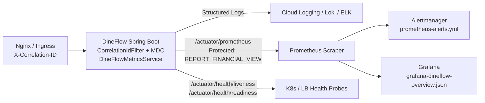

# DineFlow Observability, Structured Logging & Incident Response Runbook

## 1. Observability Architecture



---

## 2. Structured Log Schema & Correlation Traceability

- **Console Log Pattern (`application-prod.yml`)**:
  ```text
  %d{yyyy-MM-dd'T'HH:mm:ss.SSSZ} [%thread] %-5level %logger{36} - [corr:%X{correlationId:-NONE}] [tenant:%X{tenantId:-SYSTEM}] %msg%n
  ```
- **Correlation Propagation**:
  - `CorrelationIdFilter` validates incoming `X-Correlation-ID` against `^[a-zA-Z0-9_-]{4,64}$` (rejecting CRLF log-forging payloads) or generates a UUID, stores it in SLF4J MDC, and echoes it in the response header.
  - Scheduled jobs (`ScheduledReconciliationJob`) populate `MDC[correlationId]` with `job-pay-recon-<id>` / `job-ref-recon-<id>`.
  - **Sensitive Data Policy**: Never log JWTs, refresh cookies, Razorpay `keySecret`/`webhookSecret`, full phone numbers, or raw payment credentials.
- **Investigating a Failed Payment End-to-End**:
  1. Search logs by `[corr:<correlationId>]` to trace Phase A (`Payment intent persisted`), Phase B (Razorpay HTTP timeout/status), and Phase C (`PENDING_CONFIRMATION` or `PROVIDER_ORDER_CREATED`).
  2. Look up `payment_reference` and `provider_order_id` in `payment_audit_records` and `payment_webhook_events`.
  3. Inspect `GET /api/v1/payments/reconciliation/history` for subsequent ShedLock reconciliation runs.

---

## 3. Low-Cardinality Metric Inventory

*(Strict privacy rule: NEVER attach `tenantId`, `userId`, `orderId`, or phone numbers as Prometheus labels.)*

| Metric Name | Type | Labels | Purpose |
| :--- | :--- | :--- | :--- |
| `http_server_requests_seconds` | Timer | `uri`, `method`, `status` | Request rate, 5xx ratio, P50/P95 latency. |
| `hikaricp_connections_active` / `_max` / `_pending` | Gauge | `pool` | PostgreSQL connection pool saturation. |
| `dineflow_payments_initiations_total` | Counter | `provider`, `method`, `outcome` | Tracks `initiated`, `ambiguous`, `rejected`, `idempotent_replay`. |
| `dineflow_payments_settlements_total` | Counter | `method`, `source` | Tracks `api`, `webhook`, `reconciliation`, `cash`. |
| `dineflow_payments_webhooks_total` | Counter | `provider`, `outcome` | Tracks `processed`, `ignored`, `failed`, `invalid_signature`. |
| `dineflow_refunds_executions_total` | Counter | `method`, `outcome` | Tracks `succeeded`, `failed`, `ambiguous`. |
| `dineflow_reconciliation_runs_total` | Counter | `type`, `status` | Scheduled job completion/failure tracking. |
| `dineflow_reconciliation_pending_confirmation` | Gauge | — | Live count of ambiguous payments awaiting reconciliation. |
| `dineflow_outbox_backlog` | Gauge | `status` (`pending` / `dead_letter`) | Real-time outbox publication delay & dead-letter monitor. |
| `dineflow_kitchen_active_queue` | Gauge | — | Active `ACCEPTED` + `PREPARING` kitchen tickets. |
| `dineflow_ratelimit_requests_total` | Counter | `category`, `outcome`, `store` | Allowed, rejected (429), and fallback decisions. |
| `dineflow_ratelimit_redis_latency_seconds` | Timer | `category` | Redis Lua execution latency. |
| `dineflow_ratelimit_redis_failures_total` | Counter | `category` | Redis outage/timeout detection. |
| `dineflow_cache_requests_total` | Counter | `cache`, `outcome` | Public menu cache hit/miss/error ratio. |
| `dineflow_storage_operations_total` | Counter | `backend`, `operation`, `outcome` | S3/local upload/download/timeout errors. |

---

## 4. Health Endpoints (`application-prod.yml`)

- **Liveness**: `GET /actuator/health/liveness` (`livenessState` only — restarts only if JVM is wedged).
- **Readiness**: `GET /actuator/health/readiness` (`readinessState,db` — checks PostgreSQL without letting a transient Redis blip drop healthy pods that are safely running on `LOCAL_FALLBACK`).
- **Access Control**: `/actuator/health/**` is public (status only, `show-details: when_authorized`); `/actuator/prometheus` and `/actuator/metrics/**` strictly require `REPORT_FINANCIAL_VIEW` (plus Nginx internal-network CIDR restriction).

---

## 5. Incident Response & Escalation Matrix

| Alert (Provisional Baseline) | Severity | Business Impact | First Diagnostic Steps | Recovery Procedure | Escalation |
| :--- | :---: | :--- | :--- | :--- | :--- |
| `DineFlowPaymentProviderFailureSpike` | Critical | Guests cannot initiate online payments. | Check Razorpay status page + search logs for `GATEWAY_READ_TIMEOUT` / `GATEWAY_ORDER_FAILED`. | Cash / Pay-at-Counter remains operational; ambiguous attempts stay `PENDING_CONFIRMATION` and auto-reconcile on recovery. | On-call Backend -> Payments Lead (15m) |
| `DineFlowWebhookFailureRateHigh` | Critical | Delayed online payment confirmations. | Check `GET /api/v1/payments/metrics/webhooks` and verify `RAZORPAY_WEBHOOK_SECRET`. | Rotate/sync webhook secret; run `POST /api/v1/payments/reconciliation/run` to settle missed captures. | On-call Backend -> Payments Lead (15m) |
| `DineFlowDbConnectionPoolExhaustion` | Critical | API timeouts across all tenants. | Check `hikaricp_connections_pending` & PostgreSQL `pg_stat_activity`. | Verify no long-running locks; scale read traffic / increase `DB_POOL_MAX` within DB limits. | On-call SRE -> DBA (10m) |
| `DineFlowRedisUnavailable` | High | Degraded multi-replica rate-limit sync & menu cache misses. | Check ElastiCache/Valkey health & `dineflow_ratelimit_redis_failures_total`. | Sensitive endpoints automatically enforce `LOCAL_FALLBACK`; restore Redis primary/failover. | On-call SRE (15m) |
| `DineFlowOutboxBacklogDelayed` | High | Delayed waiter/kitchen/customer live WebSocket updates. | Check `dineflow_outbox_backlog`, Redis Pub/Sub, and `GET /api/v1/payments/reconciliation/locks`. | Clients auto-fallback to REST polling; resolve Redis/WS issue and verify `realtimeOutboxRelayJob` drains backlog. | On-call SRE (30m) |
| `DineFlowObjectStorageErrors` | High | Menu image uploads or invoice PDF downloads failing. | Check S3/GCS endpoint, IAM role expiry, and `STORAGE_TIMEOUT` logs. | Restore IAM/endpoint; verify local fallback if during migration. | On-call SRE (30m) |
