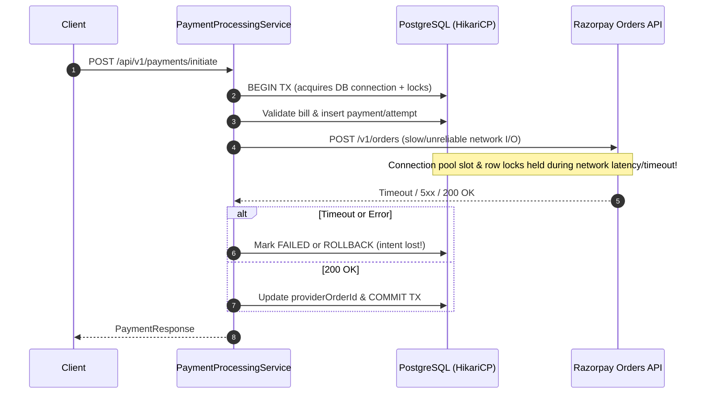
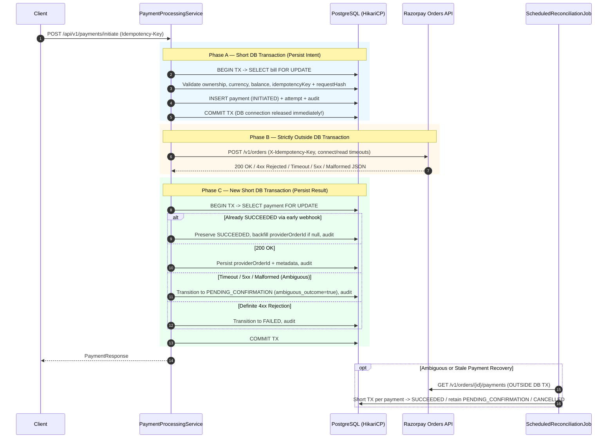
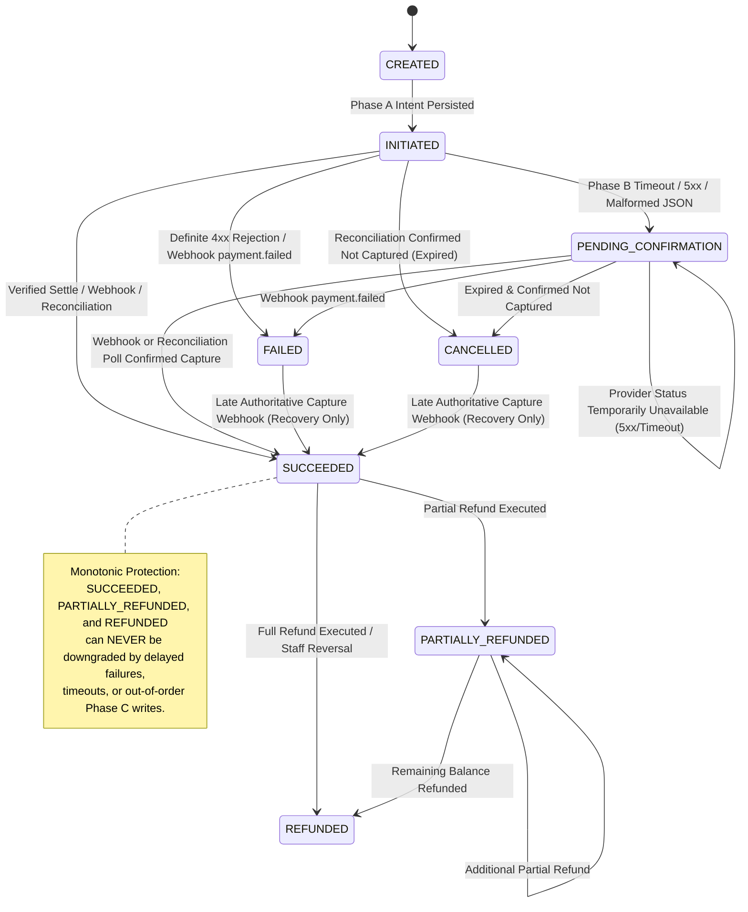

# DineFlow Payment Transaction Boundary & Financial Reliability Architecture

This document describes the Sprint 6 Master Prompt 03 hardening of DineFlow's payment initiation, webhook processing, refund execution, and reconciliation architecture.

---

## 1. Before-and-After Sequence Diagrams

### Before (Sprint 5 — Single `@Transactional` Wrapping External HTTP Call)

### After (Sprint 6 — 3-Phase Transaction Boundaries + Idempotency + Ambiguous Recovery)

---

## 2. Updated Payment State Machine (`PaymentStateMachine`)

---

## 3. Transaction Boundary & Concurrency Guarantees

1. **Zero Network I/O Inside DB Transactions**:
   - `PaymentProcessingService.initiatePayment()` uses three `TransactionTemplate` boundaries (Phase A short TX -> Phase B non-TX HTTP -> Phase C short TX).
   - `PaymentProcessingService.reconcilePendingPayments()` removes outer `@Transactional` and polls `gateway.fetchOrderStatus()` outside any DB transaction, committing each resolved payment in its own short locked transaction.
   - `RefundManagementService.executeRefund()` uses the same 3-phase `TransactionTemplate` pattern (`APPROVED` -> `INITIATED` in Phase A, gateway refund HTTP in Phase B, `SUCCEEDED`/`FAILED` or ambiguous retention in Phase C).
2. **Database-Backed Idempotency & Payload Verification**:
   - `payment_attempts` enforces `UNIQUE (tenant_id, idempotency_key)` and persists `request_hash` (SHA-256 of `tenantId|billId|paymentMethod|providerType|amount|currency`).
   - Identical retries (including concurrent threads racing on the unique constraint) replay the existing payment without issuing duplicate provider orders.
   - Reusing an `Idempotency-Key` with a mutated payload returns `409 Conflict` (`IDEMPOTENCY_KEY_PAYLOAD_MISMATCH`).
3. **Row-Level Locking & Overpayment Prevention**:
   - `RestaurantBillRepository.findByIdAndTenantIdForUpdate` and `RestaurantPaymentRepository.findByIdAndTenantIdForUpdate` serialize concurrent initiations, settlements, webhooks, and cash receipts at the PostgreSQL row level (`SELECT ... FOR UPDATE`).
   - Overpayment is explicitly blocked (`409 OVERPAYMENT_PREVENTED`) whenever a payment's payable amount exceeds the bill's locked `outstandingBalance`.

---

## 4. Operational Failure Recovery Runbook

| Failure Scenario | System Behavior | Recovery Mechanism |
| :--- | :--- | :--- |
| **Provider Read/Connect Timeout** | Phase C sets `PENDING_CONFIRMATION` + `ambiguous_outcome = true` (never `FAILED`). | Webhook resolves automatically via `notes.paymentReference` or `providerOrderId`; otherwise `ScheduledReconciliationJob` polls provider status. |
| **Provider 5xx / Malformed 2xx JSON** | Treated as ambiguous (`PENDING_CONFIRMATION`). | Retained until webhook or reconciliation confirms authoritative provider state. |
| **Provider Status API Unavailable During Reconciliation** | `fetchOrderStatus` sets `transientError = true`; payment stays `PENDING_CONFIRMATION` (never prematurely cancelled). | Automatically retried on the next ShedLock reconciliation cycle. |
| **DB Failure in Phase C After Provider Order Created** | Logs `CRITICAL_RECONCILIATION_ALERT` with `paymentId`, `paymentRef`, and `providerOrderId`. | Early webhook correlates by `notes.paymentReference` and backfills `providerOrderId`; ops can also run `POST /api/v1/payments/reconciliation/run`. |
| **Webhook Arrives Before Phase C Commits** | Webhook resolves payment via `notes.paymentReference`, settles to `SUCCEEDED`, and backfills `providerOrderId`. Phase C sees `isConfirmedOrRefunded == true` and preserves `SUCCEEDED`. | Fully automatic; audit trail records `PROVIDER_RESPONSE_AFTER_CONFIRMATION`. |
| **Delayed `payment.failed` Webhook After `SUCCEEDED`** | Rejected by `PaymentStateMachine.isConfirmedOrRefunded`; webhook stored as `IGNORED`. | No action required. |
