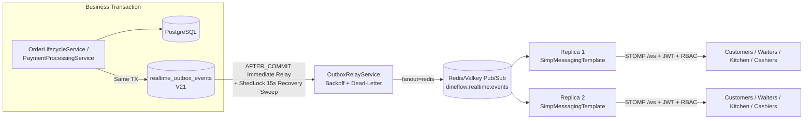

# DineFlow Real-Time Event Architecture, WebSockets & Transactional Outbox

This document specifies DineFlow's event catalog, schema, transactional outbox, multi-replica Redis Pub/Sub fan-out, WebSocket STOMP security model, and client integration contract.

---

## 1. Architecture Diagram



### Broker Decision (Why PostgreSQL Outbox + Redis Pub/Sub, NOT Kafka)
- DineFlow already runs PostgreSQL (ACID transactional outbox + ShedLock) and Redis/Valkey (rate limiting + menu cache).
- **PostgreSQL Transactional Outbox (`V21`)** guarantees durability, transactional atomicity with business writes, retry with exponential backoff, and dead-letter visibility.
- **Redis Pub/Sub (`dineflow:realtime:events`)** provides sub-millisecond multi-replica WebSocket fan-out across pods with zero additional broker infrastructure or operational overhead. Kafka/RabbitMQ is unnecessary at current scale.

---

## 2. Event Schema (`RealtimeEvent` v1.0)

```json
{
  "eventId": "f47ac10b-58cc-4372-a567-0e02b2c3d479",
  "eventType": "ORDER_READY",
  "eventVersion": "1.0",
  "tenantId": "11111111-1111-1111-1111-111111111111",
  "branchId": "22222222-2222-2222-2222-222222222222",
  "channel": "waiter",
  "resourceId": "33333333-3333-3333-3333-333333333333",
  "domainVersion": 4,
  "payload": {
    "orderId": "33333333-3333-3333-3333-333333333333",
    "orderNumber": "ORD-20261123-0042",
    "tableNumber": "T-12",
    "previousStatus": "PREPARING",
    "status": "READY"
  },
  "timestamp": "2026-11-23T15:10:00Z"
}
```

- **Safe Payloads Only**: Never includes customer phone/email, JWTs, Razorpay secrets, or raw provider webhook bodies.

---

## 3. Event Catalog & Subscription Authorization Matrix

| Topic Destination | Allowed Principals | Server-Side Authorization Rule | Events Delivered |
| :--- | :--- | :--- | :--- |
| `/topic/tenant/{tenantId}/orders/{orderId}` | Owning `GUEST`, Branch `STAFF` | `tenantId` match + DB lookup of `orderId`: `GUEST` must match `order.customerSessionId`; `STAFF` must match `branchId`. | `ORDER_PLACED`, `ORDER_ACCEPTED`, `ORDER_PREPARING`, `ORDER_READY`, `ORDER_SERVED`, `ORDER_CANCELLED` |
| `/topic/tenant/{tenantId}/sessions/{sessionId}` | Owning `GUEST` only | `tenantId` match + `principal.type == GUEST` + `principal.userId == sessionId`. | Guest-facing `PAYMENT_SETTLED`, `REFUND_EXECUTED` |
| `/topic/tenant/{tenantId}/branch/{branchId}/kitchen` | `KITCHEN_STAFF`, `BRANCH_MANAGER`, `HOTEL_ADMIN`, `HOTEL_OWNER` | `STAFF` + `tenantId` + `branchId` + `KITCHEN_VIEW`/`KITCHEN_UPDATE`/`ORDER_MANAGE`. | `ORDER_ACCEPTED`, `ORDER_PREPARING`, `ORDER_READY`, `ORDER_CANCELLED` |
| `/topic/tenant/{tenantId}/branch/{branchId}/waiter` | `WAITER`, `BRANCH_MANAGER`, `HOTEL_ADMIN`, `HOTEL_OWNER` | `STAFF` + `tenantId` + `branchId` + `WAITER_VIEW`/`ORDER_SERVE`/`ORDER_MANAGE`. | `ORDER_PLACED`, `ORDER_ACCEPTED`, `ORDER_PREPARING`, `ORDER_READY`, `ORDER_SERVED`, `ORDER_CANCELLED` |
| `/topic/tenant/{tenantId}/branch/{branchId}/payments` | `CASHIER`, `BRANCH_MANAGER`, `HOTEL_ADMIN`, `HOTEL_OWNER` | `STAFF` + `tenantId` + `branchId` + `PAYMENT_VIEW`/`PAYMENT_PROCESS`/`BILL_VIEW`/`REFUND_APPROVE`. | `PAYMENT_SETTLED`, `CASH_COLLECTED`, `REFUND_EXECUTED` |

---

## 4. WebSocket Hardening & Outbox Reliability

- **Endpoint**: `/ws` (STOMP over WebSocket, explicit `dineflow.cors.allowed-origins`).
- **Transport Limits**: `64 KB` max message size, `512 KB` send buffer, `15s` send timeout, `10s / 10s` STOMP heartbeats.
- **Connection Limits**: `WebSocketConnectionTracker` caps concurrent sessions at `10` per principal and cleans up automatically on `SessionDisconnectEvent`.
- **Outbox Retry & Retention**:
  - `OutboxRelayService` retries transient failures with exponential backoff (`10s * 2^(n-1)`, max `5` attempts) before moving to `FAILED_DEAD_LETTER`.
  - `realtimeOutboxPruneJob` (ShedLock, daily 03:15 UTC) deletes `PUBLISHED` outbox rows older than 7 days.
- **Metrics**: `dineflow_realtime_outbox_events_total{outcome=published|retry_scheduled|dead_letter}`, `dineflow_realtime_ws_connections_total{event=connect|disconnect}`.

---

## 5. Client Integration Contract (Ordering, Deduplication & Reconnection)

1. **Handshake**: Connect to `/ws` passing `Authorization: Bearer <access_token>` in STOMP `CONNECT` native headers.
2. **Deduplication**: Maintain a bounded LRU set of processed `eventId` values; ignore duplicate `eventId`s (at-least-once delivery).
3. **Out-of-Order Protection**: Ignore incoming updates where `domainVersion < currentLocalVersion` (or `timestamp` older than last REST refresh).
4. **Reconnection & Authoritative State**: WebSocket events are notifications only — never payment or authorization proof. On every reconnect (with exponential backoff), immediately call the authoritative REST endpoint (`GET /api/v1/orders/{id}`, `GET /api/v1/kitchen/orders`, `GET /api/v1/payments`) to resync full state.
