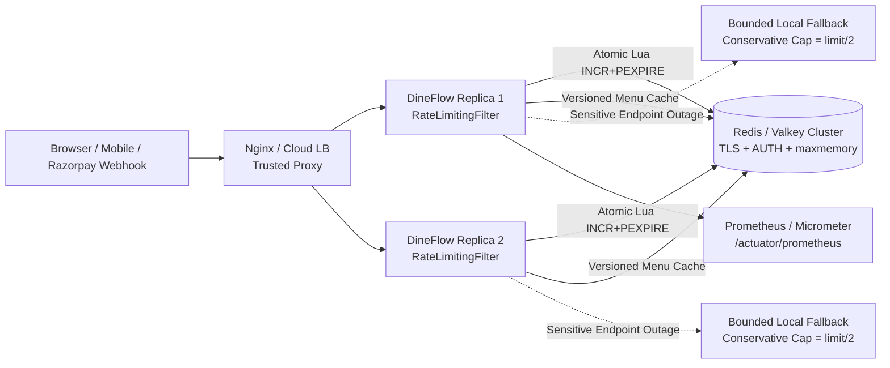

# DineFlow Redis / Valkey Distributed Rate Limiting & Caching Architecture

This document defines DineFlow's distributed rate-limiting, failure-policy, caching, observability, and Redis/Valkey operations architecture.

---

## 1. Architecture Diagram



---

## 2. Key Naming Strategy (Zero PII, Bounded Memory)

| Purpose | Key Pattern | TTL | PII Safety |
| :--- | :--- | :--- | :--- |
| **Rate-Limit Bucket** | `dineflow:rl:v1:{category}:{sha256_16(tenant\|branch\|actorOrIp)}` | `60s` (`PEXPIRE`) | Raw IPs, user IDs, phone numbers, and emails are **never** stored in Redis keys. |
| **Menu Cache Version** | `dineflow:cache:v1:menu:ver:{tenantId}` | Persistent counter | Non-sensitive tenant UUID; O(1) invalidation via `INCR`. |
| **Menu Catalog Projection** | `dineflow:cache:v1:menu:data:{tenantId}:{branchId}:v{ver}` | `120s` (configurable) | Public menu catalog only; old versions auto-expire. |

---

## 3. Rate-Limit Policy Table & Algorithm Trade-Offs

| Category | Endpoint Pattern | Default Limit | Failure Policy (Redis Down) | Rationale |
| :--- | :--- | :---: | :--- | :--- |
| `AUTH_LOGIN` | `/api/v1/auth/login`, `/refresh`, `/password-reset` | 15 / min | `LOCAL_FALLBACK` (or `FAIL_CLOSED`) | Prevents brute-force / credential stuffing even during Redis outage. |
| `GUEST_SESSION` | `/api/v1/customer-sessions/**` | 40 / min | `LOCAL_FALLBACK` | Prevents QR session flooding. |
| `QR_VALIDATION` | `/api/v1/public/qr/**`, `/api/v1/tables/entry/**` | 60 / min | `LOCAL_FALLBACK` | Prevents table token enumeration. |
| `PAYMENT_INITIATE` | `/api/v1/payments/initiate` | 20 / min | `LOCAL_FALLBACK` (or `FAIL_CLOSED`) | Protects payment gateway quota and DB locks. |
| `COUPON_REDEEM` | `*/promotions/bills/*`, `*/promotions/validate*` | 25 / min | `LOCAL_FALLBACK` | Blocks coupon-code brute forcing. |
| `REFUND_REQUEST` | `/api/v1/refunds/**` | 15 / min | `LOCAL_FALLBACK` | Protects financial refund operations. |
| `PUBLIC_MENU` | `/api/v1/customer/menu/**` | 120 / min | `FAIL_OPEN` | Keeps guest menu browsing available during transient cache issues. |
| `MEDIA_DOCUMENT` | `/api/v1/public/images/**`, `*/invoices/*/pdf` | 120 / min | `FAIL_OPEN` | Smooth asset & receipt downloads. |
| `WEBHOOK` | `/api/v1/payments/webhook/**` | 300 / min | `FAIL_OPEN` | **Never blocks legitimate Razorpay webhook retries.** |

### Algorithm Choice: Atomic Lua Fixed Window
- **Why Atomic Lua Fixed Window (`INCR` + `PEXPIRE` + `PTTL`)**: Single Redis round-trip (`O(1)` time, `O(1)` memory per key — 1 integer vs sorted-set timestamps for sliding window log). Ideal for multi-tenant SaaS under bursty dining hours.
- **Trade-offs**:
  - *Fixed Window*: Lowest memory/CPU, minor 2x boundary-burst possibility across window edges.
  - *Sliding Window Log*: Exact smoothing, but stores every request timestamp (`O(N)` memory per key).
  - *Token Bucket*: Smooth burst shaping, requires storing 2 fields (`tokens`, `last_refill`) per key.

---

## 4. Safe Caching Policy Table

| Data Type | Cached? | Key Scope | TTL & Invalidation |
| :--- | :---: | :--- | :--- |
| Public Menu Catalog (categories, items, branch overrides, currency/tax) | **Yes** | `tenantId` + `branchId` + `version` | `120s` TTL + instant O(1) `INCR` invalidation on every `MenuCategoryService` / `MenuItemService` mutation + per-key stampede lock. |
| Guest Table Number / Session Context | **No** | — | Always loaded live from `CustomerSession`. |
| Payment Status / Settlement State | **No** | — | Authoritative PostgreSQL ledger only. |
| Refund Approval / Execution State | **No** | — | Authoritative PostgreSQL ledger only. |
| Bill Balances / Financial Reports | **No** | — | Authoritative PostgreSQL ledger only. |

---

## 5. Configuration Reference & Monitoring Metrics

### Configuration (`application-prod.yml`)
```yaml
dineflow:
  rate-limit:
    enabled: true
    store: redis # ProductionConfigurationValidator fails fast if not 'redis'
    strict-fail-closed-on-sensitive: false # set true to reject auth/payment when Redis is unreachable
    trusted-proxies:
      - "10."
      - "172.16."
      - "192.168."
      - "127.0.0.1"
  cache:
    menu-ttl-seconds: 120
```

### Micrometer / Prometheus Metrics
- `dineflow_ratelimit_requests_total{category, outcome, store}` — `allowed`, `rejected`, `fail_open`, `fail_closed`, `fallback_allowed`, `fallback_rejected`.
- `dineflow_ratelimit_redis_latency_seconds{category}` — Redis Lua execution latency histogram.
- `dineflow_ratelimit_redis_failures_total{category}` — Redis timeout/connection error counter.
- `dineflow_cache_requests_total{cache="public_menu", outcome}` — `hit`, `miss`, `error`.
- `dineflow_cache_invalidations_total{cache="public_menu"}` — menu version bump count.

---

## 6. Local Dev & Production Provisioning

- **Local Development**: `docker compose up -d redis` (uses Redis 7 from [docker-compose.yml](file:///c:/Users/manoz/.gemini/antigravity/scratch/dineflow/docker-compose.yml)). To execute the live Redis integration test locally, start Redis on `127.0.0.1:6379` (or set `REDIS_TEST_HOST` / `REDIS_TEST_PORT`) and run `.\mvnw test -Dtest=DistributedRateLimitingAndCacheTests`.
- **Production Provisioning**: Provision managed AWS ElastiCache (Valkey/Redis 7) or GCP Memorystore with:
  - TLS in transit (`rediss://`) and Redis AUTH / ACLs enabled.
  - `maxmemory-policy volatile-lru` (evicts only keys with TTL; protects persistent version counters).
  - Multi-AZ replication with automatic failover.
